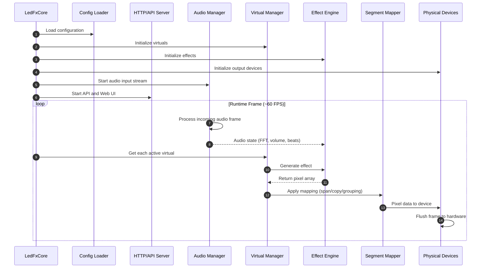

# Architecture notes

For a general overview read [copilot-instructions.md](https://github.com/LedFx/LedFx/blob/main/.github/copilot-instructions.md) in the .github directory.

This file is also used to prime your copilot context if working in VS Code.

The following are generated via AI assisted spelunking, but are then hand curated for relevance.

## LedFx runtime flow

## Preview sampling

Websocket clients see pixels through `visualisation_update` events, built by
the core-owned `PreviewSampler` (`ledfx/preview.py`):

- After rendering a frame, a virtual (in `_fire_update_event`) and a device
  (in `update_pixels`, before `flush`) ask the sampler whether a
  `visualisation_update` subscriber could match that source. Only then do
  they copy the frame and submit the copy, from the render thread.
- The sampler keeps only the newest frame per source, keyed by
  `(is_device, id)`. Older frames that were not yet sent are dropped.
- One tick on the event loop encodes each due frame and fires it, at most
  `visualisation_fps` times a second per source. The schedule advances on a
  fixed grid, so a 62 FPS source still previews at 60 FPS, and a source that
  was idle does not get a burst of old frames. Only that tick creates timers.
- `visualisation_maxlen`, `ui_brightness_boost` and `transmission_mode` are
  read when encoding, so changing them needs no restart.
- When the last matching subscriber leaves, the pending frame is dropped at
  the next tick. Deleting a virtual or device drops its pending frame.
- The raw `virtual_update` and `device_update` events are built only when an
  in-process listener has subscribed to them.
